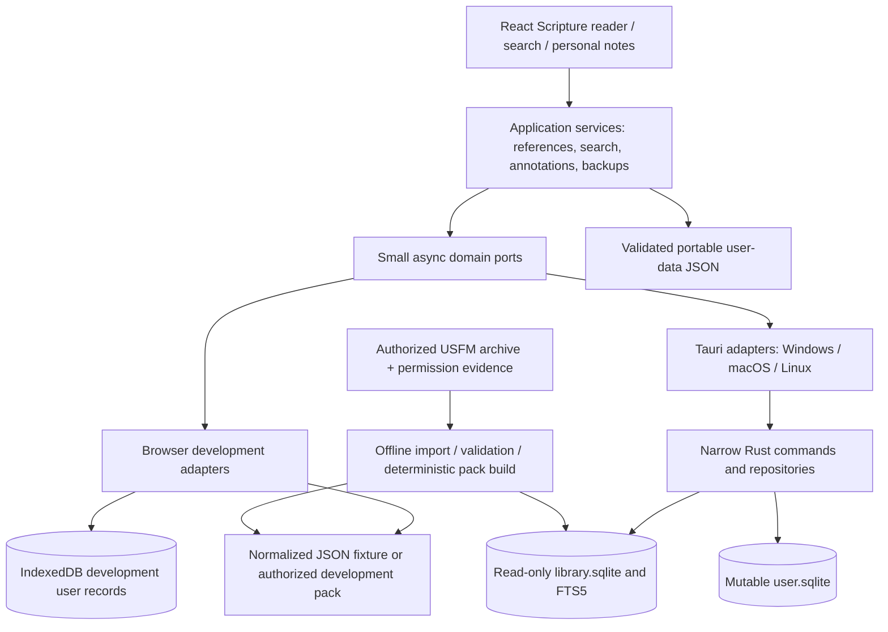

# Architecture

Status: adopted baseline for Phase 1, updated 2026-10-20 to include Linux desktop in V1. These are design decisions; platform functionality is proven only by the tests in [TESTING_STRATEGY.md](TESTING_STRATEGY.md). See [README.md](README.md) for decision precedence and open product choices.

## System boundary

One React application serves rapid browser development and the Windows, macOS and Linux desktop application. A single composition root selects adapters; features do not detect the runtime or import Tauri APIs. The distributed application needs no account, server, remote font, CDN asset, telemetry endpoint, or network connection to read, search, annotate, or back up local data.

Linux is a required V1 desktop release target. The proposed initial Linux qualification baseline is Ubuntu 24.04 LTS x86_64 with GNOME, with `.deb` as the primary planned package; this does not promise arbitrary distribution or desktop-environment support. Tauri uses GTK3 and WebKitGTK 4.1 on Linux. Build hosts need their development prerequisites, while installed applications rely on declared system runtime dependencies; a `.deb` must not be described as carrying a complete private system WebKit. End users do not install Node or Rust. The detailed package and clean-host qualification gate belongs to [RELEASE_STRATEGY.md](RELEASE_STRATEGY.md).



The browser is a development and interaction-test target, not a second production product. It uses the same domain and feature code. The synthetic pack is explicitly labeled as test content, has no claimed Bible edition, and cannot satisfy a public-release content gate.

## Boundaries and dependency direction

| Layer                  | Owns                                                                                          | Must not do                                         |
| ---------------------- | --------------------------------------------------------------------------------------------- | --------------------------------------------------- |
| `src/domain`           | Data types, identities, invariants, repository interfaces                                     | Import React, Tauri, IndexedDB or component code    |
| `src/services`         | Reference parsing, query parsing, copy formatting, application workflows                      | Render UI or issue SQL                              |
| `src/features`         | React composition and feature state, hooks calling services                                   | Access browser/native persistence directly          |
| `src/components`       | Licensed UI primitives and shared application compositions                                    | Know Scripture storage or select runtime adapters   |
| `src/adapters/browser` | Fixture reads and IndexedDB transactions                                                      | Be imported by the desktop composition path         |
| `src/adapters/tauri`   | Typed `invoke` calls and transport validation                                                 | Hide failures with a browser fallback               |
| `src-tauri/src`        | App-data paths, read-only content handle, user SQLite transactions, scoped native file access | Expose generic SQL or arbitrary filesystem commands |
| `tools/scripture`      | Build-time import, validation, pack manifests and reports                                     | Fetch content at runtime or alter Scripture wording |

Use explicit functions and constructor arguments. A few ports are sufficient; no service locator, event bus, CQRS layer, generic repository base class, plugin registry, or dependency-injection container is needed.

## Initial contracts

These are design signatures, not supported public APIs. Refine them directly before V1.0 as tests expose better representations. The authoritative record fields are in [DATA_MODEL.md](DATA_MODEL.md).

```ts
interface ScriptureLibrary {
  listEditions(): Promise<EditionSummary[]>;
  listBooks(editionId: string): Promise<BookSummary[]>;
  getChapter(key: ChapterKey): Promise<ChapterContent>;
  resolveReference(input: string, editionId: string): Promise<ReferenceResolution>;
  search(query: ParsedSearch, filter: SearchFilter, page: SearchPage): Promise<SearchResults>;
}

interface UserStore {
  getPreferences(): Promise<Preferences>;
  savePreferences(patch: PreferencesPatch): Promise<void>;
  getReadingPosition(): Promise<ReadingPosition | null>;
  saveReadingPosition(position: ReadingPosition): Promise<void>;
  listNotes(): Promise<Note[]>;
  saveNote(note: Note): Promise<Note>; // resolve only after durable transaction commit
  deleteNote(id: string): Promise<void>;
  listAnnotations(editionId: string): Promise<Annotations>;
  saveBookmark(bookmark: Bookmark): Promise<void>;
  deleteBookmark(id: string): Promise<void>;
  saveHighlight(highlight: Highlight): Promise<void>;
  deleteHighlight(id: string): Promise<void>;
  exportSnapshot(): Promise<UserDataSnapshot>;
  replaceSnapshot(snapshot: UserDataSnapshot): Promise<void>;
}

interface PlatformFiles {
  saveBackup(snapshot: UserDataSnapshot): Promise<SaveResult>;
  openBackup(): Promise<OpenResult>;
  copyText(text: string): Promise<void>;
}
```

Implement only the operations needed by the current slice. `replaceSnapshot` is an atomic data operation; confirmation and pre-restore recovery belong in the backup workflow. Cancellation is distinct from I/O failure. Do not make success-shaped default data out of an adapter error.

## Desktop persistence choice

Use `rusqlite` with bundled SQLite behind narrow Tauri commands. This gives the application control over opening `library.sqlite` read-only, binding query parameters, enabling/checking FTS5, and committing all user-data changes within one Rust transaction. It also makes whole-snapshot export and replacement straightforward without exposing SQL execution to the WebView.

The Tauri SQL plugin is a valid alternative, but mixing it with a second Rust database layer would create two access paths. The chosen small native repository costs some Rust code and is justified by read-only content and atomic restore requirements. Reassess only with evidence; do not install both, add an ORM, or build a native server.

`library.sqlite` contains one V1 edition and its derived search index. The schema includes an edition key, allowing later authorized editions without assuming identical canons or verse numbering. `user.sqlite` contains only private user records and a schema identity. The pipeline emits JSON for inspection/browser use and SQLite for desktop runtime; desktop must not load a whole Bible JSON file into React memory. See [STORAGE_STRATEGY.md](STORAGE_STRATEGY.md).

## Runtime composition and lifecycle

1. `src/app/createServices.ts` establishes the runtime once. Native selection uses the supported Tauri API; production builds must fail clearly if native services cannot initialize.
2. In browser development, load the test manifest and IndexedDB adapter. Label development content. Production Tauri initialization never silently uses IndexedDB.
3. Initialize user storage, validate content manifest/version/hash, then resolve the saved edition and reference. If a saved edition is absent, retain its anchors, explain the absence and offer an available edition.
4. Load one chapter, its annotations and applicable settings. Render structured content with React elements. Do not insert publisher content or notes through unchecked HTML.
5. Keep reading state local to the feature. Persist position after navigation with bounded coalescing; flush on visibility change where supported, without relying on unload as the only write opportunity.
6. Serialize note saves per note. A later response cannot overwrite a newer edit. Navigate away only after pending work is durable or the user has explicitly handled a save failure.
7. On content/database failure, show a recoverable error with retry and backup access where possible. Never erase a store to recover from an unspecified error.

Before V1.0, a developer may explicitly reset disposable development stores when schema changes. This policy does not authorize silent data deletion at runtime. Public V1.0 changes the obligation: user databases require preservation and tested migrations thereafter.

## State, errors and performance

React state/context and feature hooks are sufficient initially. Add no global state manager, network query cache, router, or virtualizer without a measured need. A single-reader workspace can navigate between reader, notes and settings through explicit application state. Route/deep-link support is a later justified decision.

Transport boundaries validate unknown inputs and outputs with focused validators. Use error codes such as `CONTENT_UNAVAILABLE`, `REFERENCE_INVALID`, `QUERY_INVALID`, `STORAGE_FULL`, `WRITE_FAILED`, `BACKUP_INVALID`, and `CANCELLED`; include safe user messages and preserve drafts. Native logs never include complete notes or Scripture corpora. No automatic error reporting in V1.

Search is cancellable/logically superseded and results are paginated in canonical source order; only the current chapter is rendered. Derived text never replaces source text. The provisional performance targets and measurement hardware are owned by [PRD.md](PRD.md), rather than treated as existing results.

## Security and privacy

- Tauri capabilities allow only the main application window and required narrow operations. Omit shell, process and unrestricted filesystem access.
- Bundle all application code and reading assets. Use a restrictive production CSP. Derive development HMR exceptions from the actual server configuration; do not ship development policy in release builds.
- Resolve per-user application data paths through Tauri on Windows, macOS and Linux; do not hard-code Unix paths or write into the install directory or repository. No backend, account or credentials are needed for V1. Local data is not encrypted by the application; describe that truthfully in settings/backup help.
- Scope backup dialogs to user-chosen paths, bound file sizes and parse untrusted JSON before mutation. Use temporary files and atomic rename for output; do not copy an active SQLite file.
- Render plain notes as text. Allow only supported structural Scripture nodes; reject unknown executable content. Escape FTS syntax through a parsed query builder as well as parameterizing SQL values.
- Varlock validates build-time configuration; frontend values are public. It cannot protect a shared API key embedded in a desktop executable.

## Optional future AI boundary

This is a proposed post-V1 architecture, not a V1 dependency or permission to build an AI backend now.

```mermaid
flowchart LR
  Reader[Offline reader and local notes]
  Consent[Optional assistant: explicit per-request consent]
  Service[Authenticated remote service: quotas, budget, provider secret]
  Retrieval[Retrieval of separately approved content and context]
  Model[Model provider]
  Verify[Reference validation and exact quotation substitution]
  Answer[Labeled interpretation + database quotations + clickable references]
  Reader -. selected user-approved context .-> Consent
  Consent --> Service --> Retrieval --> Model --> Verify --> Answer
```



Start with selected-note organization and passage lookup, then evaluate retrieval-augmented answers. Retrieve passages from an authorized edition with surrounding context. The model returns structured claims and references; the system verifies reference existence/edition and renders quotations directly from the content store. Reject fabricated references and mismatched quote spans rather than repairing them with model guesses. Citation existence is insufficient: reviewers must evaluate whether the cited passage supports the interpretation.

Keep Scripture quotations, licensed commentary, user notes, and AI interpretation visually and semantically distinct. Label generated material and acknowledge insufficient evidence and interpretive disagreement. Never replace Scripture or silently translate it. Treat retrieved material as data rather than instructions; restrict tool access and test prompt injection.

Oromo evaluation must include fluent speakers and theological reviewers, with fixed cases for Oromo comprehension, passage relevance, exact quotations, citation support, uncertainty and harmful overconfidence. Establish numeric pilot thresholds before selecting a provider; do not claim English-equivalent quality without measured results. A pilot must reject any invalid citation and any quotation mismatch in its release evaluation set.

Remote assistance requires an explicit opt-in and a preview of the selected passages/note text being transmitted; no entire notebook upload by default. Explain provider retention and deletion limits. Keep user drafts intact; generated edits are previews until accepted. A developer-funded provider key stays on an authenticated backend, with rate limits, per-user token limits, global spending caps, short request timeouts and revocation. Cache only content permitted by its license and consent policy. Bring-your-own-key and local models are alternatives to evaluate later, including OS-keystore storage and hardware/language costs; neither is needed for V1.

The AI panel can fail, be disabled or be removed without affecting reading, search, notes or backup. Verify licensing separately for remote processing, retrieval, quotations and resource distribution before a pilot.

## Architectural acceptance gates

- The browser and desktop use the same React feature modules and domain types; adapter contract tests exercise identical operations.
- A public production desktop build contains no browser adapter imports, test corpus, remote assets or provider secrets. Explicit development desktop builds may use the labeled synthetic pack to prove native integration.
- Rust opens content read-only and demonstrates that a write attempt fails; user transactions are parameterized and restore is atomic under injected failure.
- The selected edition's bridges, footnotes, poetry and cross-references survive the importer/display integrity fixtures.
- Phase 1 proves native startup, SQLite save/reopen, content reads and clipboard behavior on Windows, macOS and the Linux qualification baseline before claiming native integration complete. Browser builds and headless Rust tests do not demonstrate a native window launch. A Linux desktop pass qualifies only the recorded Linux environment; Windows/macOS evidence is separate.
- Public V1 includes a clean-host Linux `.deb` install/launch, offline reader and persistence/backup checks, and the package lifecycle checks in [RELEASE_STRATEGY.md](RELEASE_STRATEGY.md). Passing a development launch alone does not satisfy packaging qualification.
